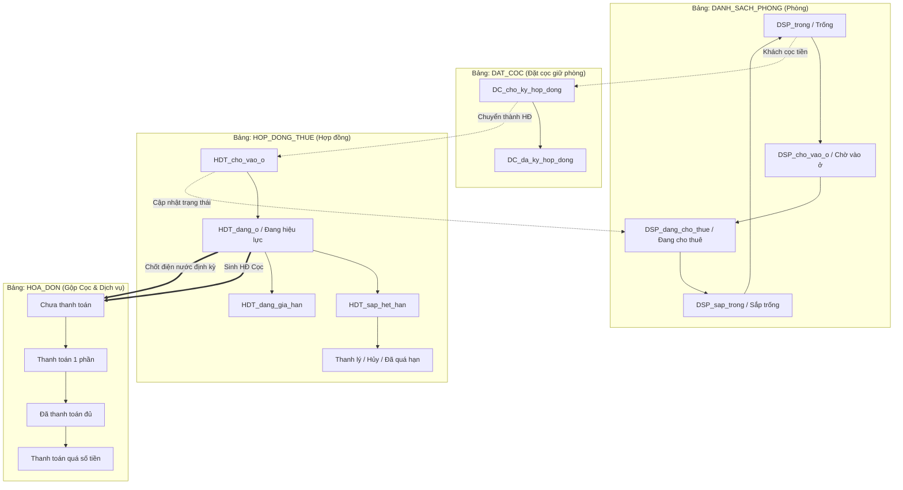

# Tài liệu Vận hành & Cấu trúc Hệ thống Quản lý CHDV VSmart

## 1. Cơ sở dữ liệu và Quy tắc chung
* **Database:** [Truy cập Google Sheets VSmart](https://docs.google.com/spreadsheets/d/1asbcvM9DmGkn6tMdbCp37mQZ9xk7_Y7YyeMCs61tnqA/edit?usp=sharing)
* **Quy chuẩn danh pháp:** Tuân thủ tuyệt đối quy tắc đặt tên cột, slide, view theo file PDF tiêu chuẩn.
* **Cấu trúc bắt buộc:** Mọi bảng trong hệ thống đều phải chứa 4 cột hệ thống: `id`, `ngay_tao`, `nguoi_tao`, `update`.

## 2. Quy tắc Bảng dữ liệu cốt lõi
### Bảng SOURCE (Danh mục hệ thống)
* **Quy tắc Key - Label:** Cột Key chứa giá trị kỹ thuật cố định (không được phép thay đổi để tránh gãy công thức). Cột hiển thị chứa nhãn Tiếng Việt dành cho người dùng.
* **Phân quyền:** Bảng này bị ẩn form chỉnh sửa với người dùng thường. Chỉ Admin mới có quyền thao tác và khóa cột `id`.

### Bảng HOA_DON (Quản lý thu chi)
Bảng `HOA_DON_COC` đã được gộp chung vào bảng `HOA_DON` để quản lý tập trung. Các loại hóa đơn bao gồm:
* `HD_tien_coc`
* `HD_tien_thue_va_dich_vu`
* `HD_tien_dien_nuoc`
* `HD_tong_hop`

---
## 3. Sơ đồ Luồng vận hành (Workflow)

### 3.1. Luồng trạng thái phòng và phát sinh hóa đơn


sequenceDiagram
    participant Admin as Người quản trị (Admin)
    participant SOURCE as Bảng SOURCE
    participant App as AppSheet (Giao diện)
    participant User as Nhân viên

    Admin->>SOURCE: Thêm dữ liệu (Key="HD_tien_coc", Label="Hóa đơn tiền cọc")
    Admin->>SOURCE: Khóa cột ID (Cấm edit)
    
    App->>SOURCE: Lấy danh sách Label 
    App-->>User: Hiển thị giao diện Dropdown ("Hóa đơn tiền cọc")
    
    User->>App: Chọn loại hóa đơn
    App->>SOURCE: Map về ID kỹ thuật ("HD_tien_coc")
    App->>App: Lưu dữ liệu Hóa Đơn với ID chuẩn
    
    Admin->>SOURCE: Đổi Label thành "Tiền cọc phòng" (Giữ nguyên ID)
    SOURCE-->>App: Tự động cập nhật mọi dữ liệu cũ theo Label mới
```
